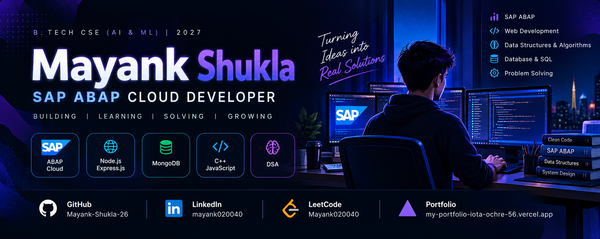

  

# 👋 Hey, I'm Mayank Shukla

### SAP ABAP Cloud Developer | B.Tech CSE (AI & ML) | 2027

---

## 👨‍💻 About Me

- 🎓 B.Tech Computer Science (AI & ML), graduating in 2027.
- ☁️ SAP Certified Back-End Developer — ABAP Cloud.
- 🏢 Building enterprise applications with SAP ABAP.
- 🌐 Developing full-stack web applications using Node.js, Express.js, and MongoDB.
- 🧠 Practicing Data Structures and Algorithms in C++.
- 🎯 Interested in entry-level SAP ABAP and back-end development roles.

## 🛠️ Tech Stack

### SAP & Enterprise Development

### Web Development

### Programming & Tools

## 🚀 Featured Projects

### 📦 SAP Courier & Parcel Delivery Tracking System

A SAP ABAP application for parcel booking, status updates, tracking reports, and courier receipt generation.

**Key Features**
- 🗄️ Designed four custom database tables using ABAP Dictionary (SE11).
- 🖥️ Developed Module Pool screens for parcel booking and status updates using PBO/PAI.
- 📊 Created an ALV report with filters for parcel ID, agent, status, and service type.
- 📝 Implemented parcel status-change audit logging.
- 🧾 Generated courier delivery receipts using Smart Forms.

**Technologies:** SAP ABAP · SAP GUI · Eclipse ADT · ABAP Dictionary · Module Pool · ALV · Smart Forms

---

### 🌍 WanderLust — Full-Stack Travel Marketplace

A full-stack travel marketplace where users can create property listings, leave reviews, and make bookings.

**Key Features**
- 🏡 Implemented property listing CRUD operations and authorization.
- 🔐 Added user authentication and session management with Passport.js.
- 📅 Developed booking functionality with date-conflict detection and dynamic pricing.
- ☁️ Integrated Cloudinary for property image uploads.

**Technologies:** Node.js · Express.js · MongoDB · EJS · Passport.js · Cloudinary

[💻 View WanderLust Source Code](https://github.com/Mayank-Shukla-26/WanderLust)

## 🏆 Certification

**SAP Certified Back-End Developer — ABAP Cloud**

- Issued: September 2026
- Issuer: SAP

[View SAP Certification](https://credly.com/badges/e6cbd767-9399-441e-b7ab-35367d21e5a4)

## 📊 GitHub Stats

---

### 💜 Learn. Build. Improve. Repeat.

*Thanks for visiting my profile!*

